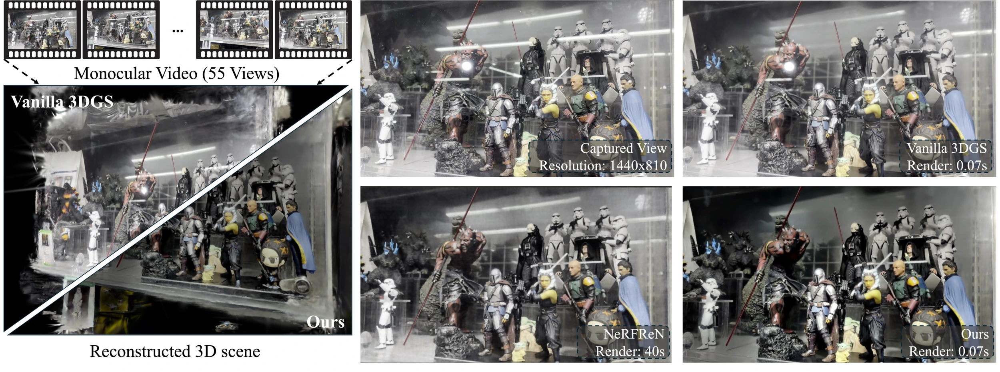
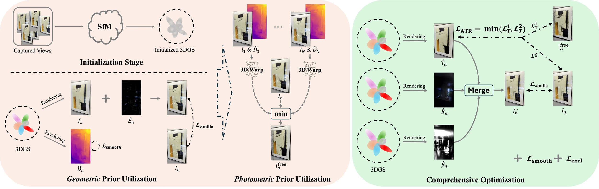
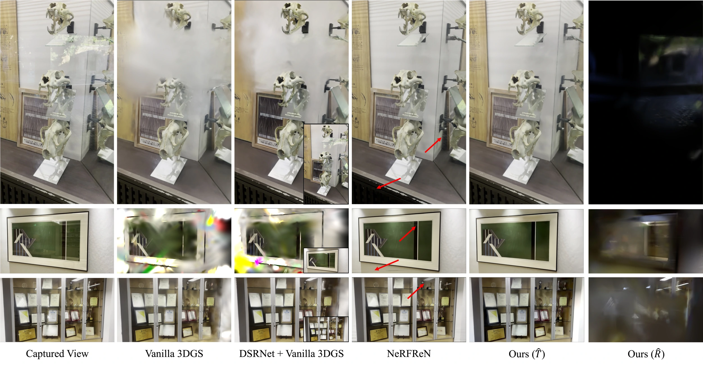
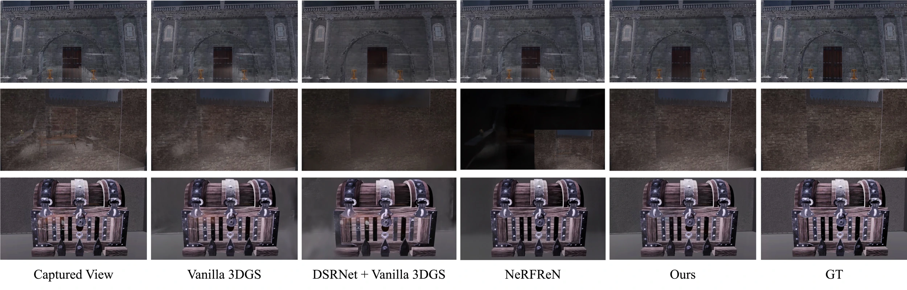

<div align="center">

# RF3DGS: Reflection-Free 3D Gaussian Splatting with Self-Priors

**Reflection-free novel-view synthesis from a monocular sRGB video**

[Project Page](https://lawrenceruan.github.io/RF3DGS/) · [Paper](docs/assets/rf3dgs-paper.pdf) · [Getting Started](#getting-started) · [Results](#results)

</div>



RF3DGS combines geometric and photometric self-priors with **Adaptive Twin Rendering (ATR)** to reconstruct a scene's transmission component from reflection-degraded multi-view observations.

## News

- **2026-11-25:** Academic project page and usage documentation added, including original paper figures, interactive comparisons, benchmark tables, and an example scene workflow.
- **2026-11-23 — ongoing internal experiments:** Transmission/color refinement, angular and facade studies, and an ATR-guided student are being explored. These are separate from the public baseline and paper results.
- **2026-11-09 — internal baseline maintenance:** Zero-safe exclusion gradients, redundant-loss cleanup, and complete layered checkpoint/RNG restoration are documented in the live Superpod baseline. Historical pixel sampling remains the default; corrected pixel-center sampling is opt-in. These fixes are not included in the initial public code import.
- **2026-11-08:** Initial public import of `013_AllStage_Real` from Superpod ([code snapshot](https://github.com/lawrenceruan/RF3DGS/commit/00e7b565828ea3011d01f721a9327b0bbc199306)).

Dates use Hong Kong time. Internal development updates do not indicate a tagged public release.

## Overview

3D reflection removal is important for high-fidelity visualization, including museum exhibitions. RF3DGS exploits the observation that the minimum pixel intensity across multiple views of the same 3D point strongly correlates with reflection-free information.

The method first optimizes a 3DGS model with a geometric prior to estimate coarse transmission depth. Depth-based warping aggregates auxiliary views into transmission pseudo-labels. ATR then combines these self-supervised signals with the original captured views to preserve high-frequency details.

## Method



1. **Initialization:** Estimate cameras and sparse geometry using SfM and initialize a Gaussian scene.
2. **Geometric self-prior:** Optimize with depth smoothness and learnable residual maps to estimate coarse transmission geometry.
3. **Photometric self-prior:** Warp auxiliary views and aggregate minimum-intensity information into transmission pseudo-labels.
4. **Adaptive Twin Rendering:** Jointly optimize scene components using pseudo-labels and original observations.

## Results

### Real-world scenes



The final two columns show RF3DGS transmission and reflection estimates. Explore the [interactive comparisons](https://lawrenceruan.github.io/RF3DGS/#results) on the project page.

### Synthetic benchmark

The paper introduces five Unity scenes with nine configurations each, for **45 evaluation cases**, varying scene content, glass thickness, transparency, and reflection strength.



### Quantitative evaluation

Values below are reported in the supplied manuscript. Higher PSNR/SSIM and lower LPIPS are better; best values are bold.

**Unity benchmark**

| Method | PSNR ↑ | SSIM ↑ | LPIPS ↓ |
| --- | ---: | ---: | ---: |
| Chugunov et al. | 2.94 | 0.248 | 0.935 |
| Vanilla 3DGS | 29.58 | **0.917** | 0.175 |
| DSRNet + Vanilla 3DGS | 26.91 | 0.872 | 0.240 |
| NeRFReN | 26.36 | 0.755 | 0.284 |
| **RF3DGS** | **31.45** | 0.915 | **0.150** |

**Real-world benchmark (TNeRF)**

| Method | PSNR ↑ | SSIM ↑ | LPIPS ↓ |
| --- | ---: | ---: | ---: |
| MVSNeRF | 17.83 | 0.685 | 0.400 |
| NeRFReN | 18.63 | 0.716 | 0.449 |
| TNeRF | 22.75 | 0.841 | 0.205 |
| Vanilla 3DGS | 21.73 | 0.835 | 0.238 |
| DSRNet + Vanilla 3DGS | 22.03 | 0.838 | 0.221 |
| Flash-Splat | N/A | N/A | N/A |
| **RF3DGS** | **25.04** | **0.915** | **0.190** |

Flash-Splat requires RAW inputs and is not applicable to these sRGB inputs.

## Getting started

The following instructions target the public `00e7b56` implementation. Commands have been checked against its source and argument definitions; a fresh end-to-end GPU training run has not been performed for this guide.

### Requirements and installation

Use Linux with an NVIDIA GPU, a CUDA toolkit/compiler compatible with your PyTorch build, a C++ compiler, Git, and Conda. CPU-only training is not supported.

The repository's historical environment declares Python 3.7.13, PyTorch 1.12.1, and CUDA runtime 11.6. The CUDA compiler must be installed separately. Recent GPUs may require a compatible modern stack and extension validation.

The public import contains `.gitmodules` but no submodule gitlinks. Populate the dependency directories before installing the environment:

```bash
git clone https://github.com/lawrenceruan/RF3DGS.git
cd RF3DGS

# The public import has .gitmodules but no submodule gitlinks.
mkdir -p submodules
git clone --recursive --branch dr_aa \
  https://github.com/graphdeco-inria/diff-gaussian-rasterization.git \
  submodules/diff-gaussian-rasterization
git clone https://gitlab.inria.fr/bkerbl/simple-knn.git submodules/simple-knn
git clone https://github.com/rahul-goel/fused-ssim.git submodules/fused-ssim

# Repository-provided legacy environment
conda env create --file environment.yml
conda activate gaussian_splatting
python -m pip install natsort matplotlib
python -c "import torch; import diff_gaussian_rasterization; import simple_knn._C; print(torch.__version__, torch.cuda.is_available())"
```

`natsort` and `matplotlib` are imported by the code but absent from the provided environment file. The original trainers initialize VGG and may download pretrained weights on first launch.

The internal H800 environment has passed CUDA extension smoke checks with Python 3.11.17 and PyTorch 2.8.0+cu128. It inherits a cluster installation and is not a portable public environment release.

### Prepare a scene

Capture overlapping views from a monocular sRGB video and estimate camera poses and a sparse point cloud. The paper uses VGGSfM. Export an undistorted COLMAP-format model with `PINHOLE` or `SIMPLE_PINHOLE` cameras and matching image names.

```text
my_scene/
├── images/                  # Undistorted sRGB images
│   ├── frame_000001.png
│   └── ...
└── sparse/                  # Model files directly here, not sparse/0/
    ├── cameras.bin          # Or cameras.txt
    ├── images.bin           # Or images.txt
    └── points3D.bin         # Or points3D.txt
```

The loader reads model files directly from `sparse/`, **not `sparse/0/`**. If needed, copy model files into a prepared scene directory while preserving the original reconstruction.

The public loader subsamples image folders containing more than 60 images. Review [`scene/dataset_readers.py`](scene/dataset_readers.py) when defining a split. A verified public download for the RF3DGS Unity benchmark and pretrained RF3DGS weights is not linked yet.

### Train and render

Run from the RF3DGS repository root. Replace `DATA` and choose an unused `RUN` name. This example reconstructs all selected input views and uses the L1-highlight entry point from [`run_batch_Real.py`](run_batch_Real.py).

```bash
# Run from the RF3DGS repository root. Use a new RUN name.
DATA=/absolute/path/to/my_scene
RUN=my_scene_demo
export CUDA_VISIBLE_DEVICES=0
export OMP_NUM_THREADS=8

# Stage 1: initial geometry, 5,000 iterations
python train_1st_stage.py -s "$DATA" \
  --scene_name "${RUN}/stage1" --iterations 5000 \
  --sh_degree 3 --densification_interval 500 --disable_viewer

# Render the initial transmission and depth
python render_1st_stage.py -s "$DATA" \
  -m "output/${RUN}/stage1" --iteration 5000 --skip_test

# Construct transmission pseudo-labels
python warp_images_1st_stage.py -s "$DATA" \
  -m "output/${RUN}/stage1" --iteration 5000 \
  --skip_test --threshold 10 --file_name pseudo_GT

# Stage 2: ATR optimization, 30,000 iterations
python train_2nd_stage_L1Highlight.py -s "$DATA" \
  --pseudo_source_path "output/${RUN}/stage1/train/ours_5000" \
  --scene_name "${RUN}/stage2" --iterations 30000 \
  --sh_degree 3 --densification_interval 500 --disable_viewer

# Render the transmission, reflection, and blending factor
python render_2nd_stage.py -s "$DATA" \
  -m "output/${RUN}/stage2" --iteration 30000 --skip_test
```

A reusable version with output-folder safeguards is available in [`docs/assets/run_scene.sh`](docs/assets/run_scene.sh):

```bash
bash docs/assets/run_scene.sh /absolute/path/to/my_scene unique_run_name
```

Important conventions:

- `--pseudo_source_path` points to `ours_5000`, not its `pseudo_GT` subdirectory. Stage 2 needs both `T/` and `pseudo_GT/`.
- Trainers write to `output/<scene_name>`; `-m` alone does not override this in the public snapshot.
- `--threshold 10` follows the real-scene batch script and is scene dependent.
- L2-highlight and NeRF trainers are separate entry points; do not assume identical data protocols.

### Outputs

All paths below are relative to `output/<RUN>/`.

| Location | Contents |
| --- | --- |
| `stage1/train/ours_5000/` | `T/`, `R/`, `GT/`, `Depth_png/`, `Depth_pth/`, and generated `pseudo_GT/` |
| `stage2/point_cloud/iteration_30000/` | `point_cloud_T.ply`, `point_cloud_R.ply`, `point_cloud_Beta_R.ply` |
| `stage2/train/ours_30000/` | `T/`, `R/`, `Beta_R/`, `GT/`, and depth outputs |

**The renderer's `GT/` contains original captured observations. For real scenes these can contain reflections; they are not clean transmission ground truth.**

### Evaluation

For novel-view evaluation, define a consistent held-out split from the start. The COLMAP loader's `--eval` mode holds out every eighth camera in sorted order by default. Keep held-out data out of training and pseudo-label construction.

The inherited metrics script expects lowercase `renders/` and `gt/`, whereas RF3DGS rendering produces `T/` and `GT/`. Prepare an evaluation folder with predicted transmission and matching **clean reference images**.

```bash
# Prepare a NEW evaluation folder with matching filenames.
# renders/ contains predicted transmission; gt/ contains CLEAN references.
EVAL_ROOT=/absolute/path/to/prepared_evaluation
python metrics.py -m "$EVAL_ROOT"

# Expected input:
# $EVAL_ROOT/test/rf3dgs/renders/<frame>.png
# $EVAL_ROOT/test/rf3dgs/gt/<frame>.png
# Written output: results.json and per_view.json
```

The script computes PSNR, SSIM, and VGG-based LPIPS. The all-view reconstruction example above does not automatically reproduce the paper's benchmark protocol.

## Troubleshooting

| Problem | What to check |
| --- | --- |
| Missing CUDA extension | Dependency source folders, active environment, compatible CUDA/PyTorch/compiler versions, and GPU architecture. |
| Unsupported camera model | Undistort images and use PINHOLE or SIMPLE_PINHOLE cameras. |
| Missing pseudo image | Finish stage-1 rendering and warping; check matching basenames and both `T/` and `pseudo_GT/`. |
| Existing output directory | Choose a new run name to avoid mixing caches, configurations, and checkpoints. |
| Incomplete checkpoint resume | The public second-stage trainer writes three layers to the same checkpoint filename. Do not rely on it for full layered resumption; the internal baseline fixes this. |
| Different pixel-sampling convention | Regenerate priors. Cached pseudo-labels retain the convention used to create them. |

For questions, open a [GitHub issue](https://github.com/lawrenceruan/RF3DGS/issues) with the code commit, environment, command, and relevant error output.

## Acknowledgments and license

This project builds on [3D Gaussian Splatting](https://github.com/graphdeco-inria/gaussian-splatting). The original documentation, attribution, and citation are preserved in [`README_3DGS_UPSTREAM.md`](README_3DGS_UPSTREAM.md). Please consult [`LICENSE.md`](LICENSE.md) for usage terms.
